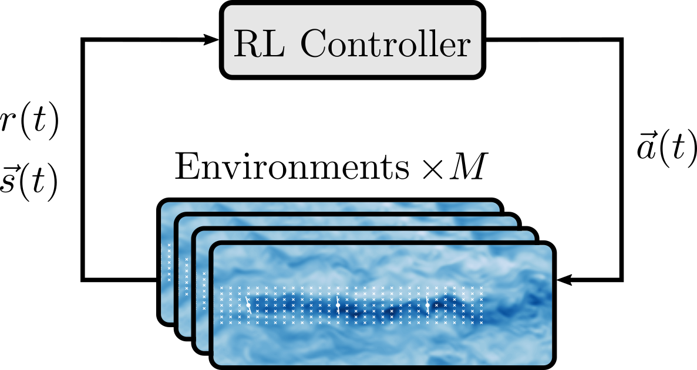
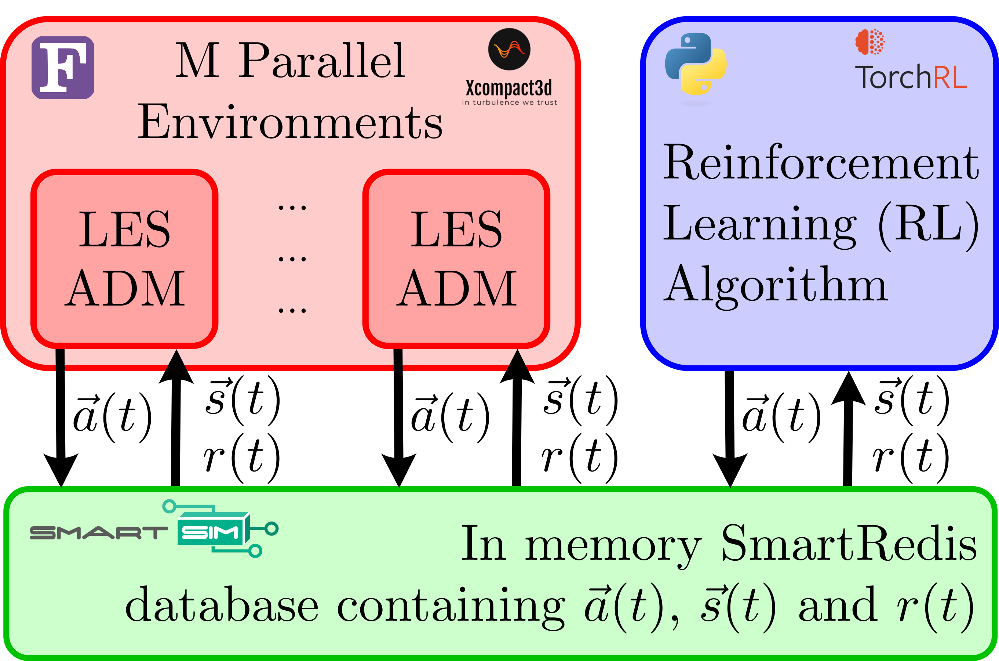

# Wind-RL
## Reinforcement Learning for Active Wind Farm Control

This repository contains code that integrates reinforcement learning with wind farm simulations to develop an active wake steering control strategy. Wake steering aims to optimise turbine yaw angles to redirect wakes and maximise the overall power production of the wind farm.

Our approach uses reinforcement learning to train control policies that adapt dynamically to varying wind conditions. By coupling an RL controller with a high-fidelity wind farm simulation environment, this framework learns optimal wake control strategies that dynamically adjust based on the wind conditions and increases the power output of the wind farm.

### Paper

[Reinforcement learning increases wind farm power production by enabling closed-loop collaborative control, Andrew Mole, Max Weissenbacher, Georgios Rigas & Sylvain Laizet, Communications Engineering, volume 5, Article number: 129 (2026)](https://doi.org/10.1038/s44172-026-00667-8)

<p align="center">



</p>

## How to install

Smartsim is used to interface the RL code here with wind farm environments simulated using [Xcompact3d](https://www.incompact3d.com/).


### Xcompact3d-SmartRedis Installation

This branch requires the matching pressure-capable [Incompact3d-WindRL fork](https://github.com/rklopsch/Incompact3d-WindRL/tree/smartRedis-coupling), not the upstream solver. Keep the solver and Wind-RL-gym checkouts side by side. Install the Python requirements below before building, since build provenance uses Python 3.10 or newer.

On Archer2
```bash
module swap PrgEnv-cray PrgEnv-gnu
module load cmake/3.21.3
cd work/<PROJECTCODE>/<PROJECTCODE>/<USERNAME>
git clone --branch smartRedis-coupling https://github.com/rklopsch/Incompact3d-WindRL.git
cd Incompact3d-WindRL
export FC=mpif90
cmake -S . -B build -DBUILD_TESTING=OFF
cmake --build ./build -j 8
```

The fork handles both SmartRedis `lib` and `lib64` installations. If a failed build previously detected a different Fortran compiler, configure a new build directory under the correct module environment rather than reusing incompatible MPI module files.

Real launchers default to `../Incompact3d-WindRL/build/bin/xcompact3d`. Override `env.solver_root` (relative to Wind-RL-gym, or absolute) and `env.solver_build` when necessary, or set `WINDRL_SOLVER_ROOT`. The source checkout must have this fork as `origin`. Launchers check the CMake source directory, source hash, executable hash and four-component protocol using the generated `build/bin/windrl-solver.json`. They never fall back to another executable on `PATH`. Rebuild after solver source changes. Each case records the verified build in `solver_build.json`.

Cloning alone is not sufficient: both repositories need the matching published CSV/pressure revisions, and real runs require SmartSim/SmartRedis, a Slurm allocation and case/precursor data. Configure `env.precursor_root` or `WINDRL_PRECURSOR_ROOT` for your own inflow data; do not reuse another user's filesystem paths. A full CFD/MPI smoke run must be performed on compute nodes, not the ARCHER2 login node.

### Python Requirements

These instructions will get SmartSim installed together with TorchRL:

0. If on Archer2 load python module and setup venv for packages
```bash
module load PrgEnv-gnu
module load cray-python
python -m venv --system-site-packages /work/<PROJECTCODE>/<PROJECTCODE>/<USERNAME>/smartsim_venv
source /work/<PROJECTCODE>/<PROJECTCODE>/<USERNAME>/smartsim_venv/bin/activate
```

1. Install torchrl with
```bash
pip install torchrl==0.2.1
```

2. Install the correct version of tensordict with 
```bash
pip uninstall tensordict
pip install tensordict==0.2.0
```

3. Uninstall the PyTorch build with
```bash
pip uninstall torch
```

4. Build SmartSim, requesting PyTorch as an ML backend (On Archer2 also need to install git-lfs before this step)
```bash
pip install smartsim==0.7.0
smart build --device cpu --no_tf
```
This will install torch 2.0.1 (CPU only).

5. Install the remaining requirements by running
```bash
pip install tqdm matplotlib hydra-core wandb f90nml
```

6. Install Numpy 1.x for compatability
```bash
pip install numpy==1.26.4
```

Happy times.


## Running

The launch scripts can be used to launch RL training, BO runs and evaluation runs.
For example to run an SAC RL training run: 

```bash
SR_LOG_FILE=./log.sr
SR_LOG_LEVEL=QUIET
python launch_sac_run.py
```

When running on HPC (ARCHER2) a submission script can be used:

### Running on Archer
Launch with submission script

```bash
sbatch submit_sac.sh
```

To change parameters either modify the relevent config files or override the config with: eg.

```bash
python launch_sac_run.py <case_name> env.turbines=10
```


## Probe Configuration

`env.probes_file` replaces `env.probes_per_turbine` and `env.flow_field_directions`. Relative CSV paths resolve from Wind-RL-gym, independently of Hydra's working directory; absolute paths are also supported. Each probe has one row:

```csv
x,y,z,ux,uy,uz,p
252,90,315,1,0,0,1
504,90,378,0,1,1,0
756,90,441,0,0,0,1
```

Coordinates are absolute solver-domain coordinates in the existing case units: `x` streamwise, `y` vertical, `z` lateral. They are not turbine offsets or diameter-normalised coordinates. The solver samples its grid at these positions, with its established boundary handling; setup rejects coordinates outside the domain. Flags must be `0` or `1`, with at least one component enabled per row. No turbine ID, equal counts or multiple-of-seven constraint is required. Duplicate positions are allowed.

Probe IDs follow CSV row order, starting at one. Observations concatenate enabled components in `ux,uy,uz,p` order within each row. The example produces five values: probe 1 `ux,p`, probe 2 `uy,uz`, probe 3 `p`. Input width is the sum of enabled flags, not a turbine-count product. Actions and power/reward handling are unchanged.

Velocity and pressure use the same existing statistics sampling and control-interval averaging. Pressure is the solver's recovered, rescaled mean pressure interpolated onto the velocity grid, not raw `pp3`; it is not asserted to be absolute pressure in pascals. Velocity normalisation remains offsets `[6,0,0]`, scales `[6,4,4]`. Pressure uses `(p - env.pressure_offset) / env.pressure_scale`, defaulting to `0` and `1`. Scale must be positive and finite. SmartRedis mean probes currently require `nstat=1` and statistics started before the first control output.

The default CSVs preserve the previous three-turbine layouts and `ux` selection: `assets/probes/current_77.csv` for SAC/PPO and `assets/probes/current_14.csv` for BO. These are static layouts; changing turbine geometry does not move them. Export the former automatic grid explicitly when needed:

```bash
python -m Solver.export_probes --config sac/config_sac.yaml --count 77 --output assets/probes/custom.csv
python launch_sac_run.py csv_run env.probes_file=assets/probes/custom.csv
```

The exporter alone retains the former multiple-of-seven restriction. Custom CSVs do not. Run launchers from the Wind-RL-gym root. Workers and solver cases receive `probes.csv` and `probe_layout.json` snapshots, including ordered feature descriptions. Dummy solvers emit the same four-component tensors, but do not require the real solver build.

Checkpoints include `observation_<id>.json`, which must accompany the model files. Loading rejects different positions, ordering, selections, normalisation, frame stacking or turbine counts, even when input widths match. Evaluation uses the training run's saved CSV. Legacy checkpoints without this metadata require explicit migration with their original observation contract; do not assume that matching dimensions imply compatibility.

Focused Python checks:

```bash
OMP_NUM_THREADS=1 MKL_NUM_THREADS=1 OPENBLAS_NUM_THREADS=1 python -m pytest tests/ -q
```

## Database Coupling Procedure

### Python

``` 
send i_sim_done = False
send i_yaws_done = False
for(frame = 0; frame < episode_length; frame += frameskip)
	calculate yaws
	send i_yaws = yaws
	send i_yaws_done = True
	while(i_sim_done == False):
		read i_sim_done
		continue
	read reward, observation
	send i_sim_done = False
```

### Fortran

```
for(frame = 0; frame < episode_length; frame += frameskip)
	while(i_yaws_done == False): 
		read i_yaws_done 
		continue 
	read i_yaws 
	send i_yaws_done = False 
	simulate frameskip timesteps with yaws
	calculate reward, observation
	send i_turbine_powers, i_probe_data = reward, observation 
	send i_sim_done = True
```

### Database content

For each environment $i \in \{0, \dots, m-1\}$   

| Name + Data type                                | Description                                                              |
| ----------------------------------------------- | ------------------------------------------------------------------------ |
| `i_yaws[nTurbines] double`                      | Turbine angles generated by Python                                       |
| `i_yaws_done int`                               | Python has generated new angles (0 = False, 1 = True)                    |
| `i_sim_done int`                                | xCompact3D has completed simulation of `frameskip` (0 = False, 1 = True) |
| `i_turbine_powers[nTurbines] double`            | Reward: power generated by each turbine                                  |
| `i_probe_j[4] double`                          | Probe j averaged values `[ux,uy,uz,p]`; CSV flags select the agent inputs |
